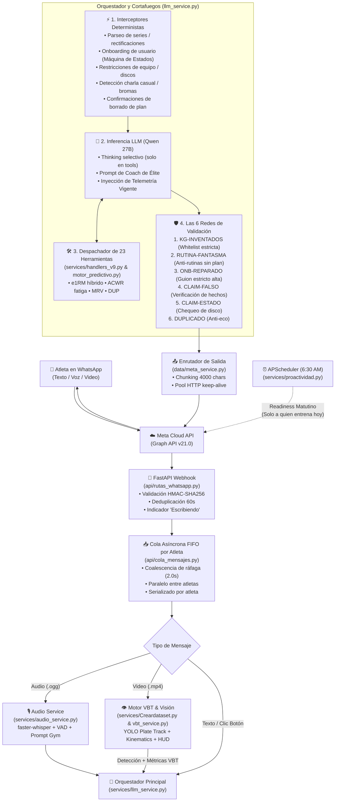
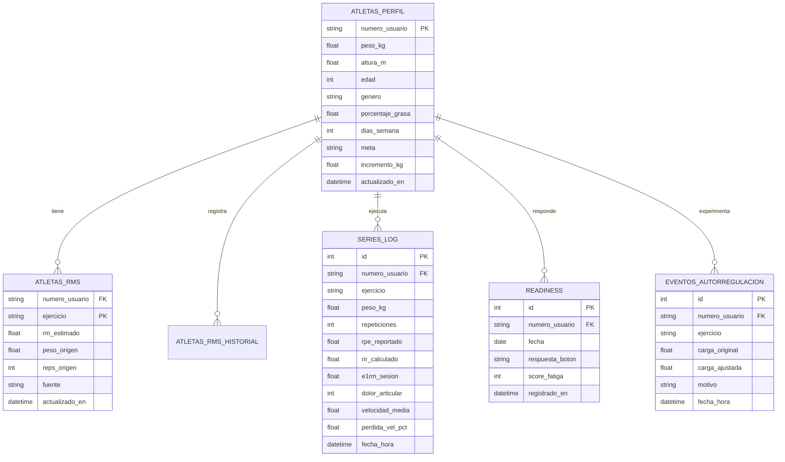

# 🗺️ MAPA DEL SISTEMA — IRON PROGRESS V9 (COACH PREDICTIVO)

> **Documento de Orientación Cognitiva e Intuición Arquitectural**  
> *Diseñado para que cualquier Modelo de Lenguaje (LLM) o Desarrollador comprenda instantáneamente qué hace cada archivo, cómo fluyen los datos y qué reglas de diseño gobiernan el sistema.*

---

## 🧭 1. Modelo Mental: La Filosofía de Iron Progress

Para interactuar correctamente con este repositorio, cualquier modelo debe interiorizar un **principio rector absoluto**:

```
┌──────────────────────────────────────────────────────────────────────────────┐
│                            PRINCIPIO FUNDAMENTAL                             │
│                                                                              │
│    "Python es el cerebro determinista que calcula, audita y decide.         │
│     El LLM es la voz del coach de élite que redacta y empatiza.             │
│     El LLM NUNCA calcula, NUNCA inventa rutinas y NUNCA improvisa datos."   │
└──────────────────────────────────────────────────────────────────────────────┘
```

1. **Separación Estricta de Competencias**:
   - Los LLMs son malos en aritmética, sufren alucinaciones numéricas y derivan con el tiempo.
   - En Iron Progress, **todas las matemáticas** (e1RM, RIR, RPE, fatiga ACWR, periodización DUP, selecciones de ejercicios, redondeos a discos reales) son ejecutadas por algoritmos deterministas en Python.
   - El LLM (Qwen 27B local sobre Ollama y GPU ROCm) recibe bloques inyectados con asteriscos `*X kg*` y su único trabajo es **transcribirlos de forma literal y comunicarlos con empatía humana**.
2. **Zero-Trust hacia la Salida del LLM**:
   - La respuesta generada por el LLM pasa por una batería de **6 redes de validación secuenciales (cortafuegos)** antes de salir a WhatsApp. Si el modelo alucina kilos, inventa rutinas inexistentes o afirma haber guardado algo que falló, Python intercepta el borrador y lo reescribe o aplica un fallback honesto.
3. **Operación Local-First**:
   - Privacidad completa del atleta: modelo local en servidor propio, embeddings locales en ChromaDB, transcripción local con Whisper y visión por computadora local con YOLO y MediaPipe. Cero llamadas a APIs de OpenAI o nubes externas para datos del usuario.

---

## 🏛️ 2. Arquitectura General y Ciclo de Vida del Mensaje



---

## 📂 3. Inventario y Mapa Detallado de Archivos

A continuación se detalla la intuición, responsabilidad, entradas, salidas y dependencias de cada archivo del proyecto.

### 🏠 3.1. Raíz del Proyecto

| Archivo | Intuición y Responsabilidad | Entradas / Salidas |
| :--- | :--- | :--- |
| `main.py` | **Punto de entrada de la aplicación FastAPI.** Inicializa el servidor Uvicorn, configura el ciclo de vida (`lifespan`), arranca el scheduler matutino de readiness (6:30 AM), la tarea de limpieza periódica de videos temporales y administra el drenado ordenado de la cola de mensajes al apagar el servidor. | **In:** Peticiones HTTP de Meta.<br>**Out:** Servidor HTTP activo en `0.0.0.0:8000`, estado de salud en `/`. |
| `Modelfile` | **Configuración de Ollama para el modelo del coach.** Basado en `Qwen3.8:27b` (o versión correspondiente). Fija parámetros de inferencia: `temperature 0.3`, `num_ctx 16384` y desactiva predicción especulativa inestable (`draft_num_predict 0`). | **Configura:** Instancia de Ollama local. |
| `requirements.txt` | **Dependencias de producción congeladas para Python 3.12.** Incluye FastAPI, Uvicorn, HTTPX, Ollama, LangChain, ChromaDB, APScheduler, Scikit-Learn, OpenCV, MediaPipe, Ultralytics (YOLO) y Faster-Whisper. Incluye advertencias de instalación para PyTorch con aceleración ROCm. | **Uso:** `pip install -r requirements.txt`. |
| `README.md` | **Documentación ejecutiva y de presentación del proyecto.** Explica la propuesta de valor ("un entrenador de fuerza que vive en tu WhatsApp"), la arquitectura general, ejemplos reales de conversación, y las tecnologías utilizadas. | Documentación humana. |
| `auditor_rocm.sh` | **Script de diagnóstico de aceleración AMD ROCm.** Verifica módulos del kernel `amdgpu`, permisos de `/dev/kfd` y `/dev/dri`, pertenencia a grupos `video` y `render`, instalación de ROCm 7.2.1 y compatibilidad de la GPU RX 7900 XTX para evitar que Ollama caiga a RAM. | **Uso:** `./auditor_rocm.sh` |
| `cazador_apu_rocm.sh` | **Aislamiento de GPU discreta.** Script para evitar que PyTorch o ROCm seleccionen por error la gráfica integrada (APU) del procesador en lugar de la tarjeta dedicada de 24 GB. | **Uso:** Diagnóstico de hardware. |
| `monitor_freeze.sh` | **Vigilante de estabilidad del sistema.** Monitorea la memoria VRAM y RAM durante sesiones de inferencia pesadas para prevenir bloqueos del kernel o congelamientos. | **Uso:** Monitoreo en segundo plano. |
| `errores_post_practicas.md` | **Bitácora técnica de deuda y hallazgos.** Documenta discrepancias encontradas en pruebas reales (como el reporte agrupado de series múltiples y la alucinación cruzada de nombres de ejercicios) y sus soluciones. | Documentación técnica. |
| `errores_cl.md` | **Registro de errores en clasificadores y filtros.** Analiza falsos positivos en la expresión regular de `CLAIM-FALSO` y pautas para refinamiento. | Documentación técnica. |
| `hud_demo.png` | **Muestra visual del renderizado VBT.** Captura de pantalla del HUD superpuesto en video (trayectoria, barras de velocidad, pérdida de velocidad y repeticiones). | Recurso visual. |

---

### ⚙️ 3.2. Directorio `core/` (Configuración e Identidad)

| Archivo | Intuición y Responsabilidad | Claves Técnicas |
| :--- | :--- | :--- |
| `core/config.py` | **Central de configuración y entorno.** Carga `.env` mediante `python-dotenv` y expone el objeto singleton `settings`. Limpia comillas y espacios en tokens, define URLs de Meta Graph API v21.0 y genera diagnósticos legibles en consola de variables faltantes al arrancar. | `Settings`, `VERIFY_TOKEN`, `ACCESS_TOKEN`, `PHONE_NUMBER_ID`, `APP_SECRET`, `GRAPH_VERSION`. |
| `core/ejercicios.py` | **Identidad canónica del ejercicio.** Unifica la nomenclatura en todo el sistema. Resuelve el problema donde la visión decía `"Press banco"`, el LLM `"Press Banco Plano"` y el webhook `"press_banca"`. Aplica reglas ordenadas de específico a general (evita que `"press inclinado"` se clasifique erróneamente como `"press"` o `"jalón al pecho"` como `"pecho"`). | `canonizar(texto)`, `normalizar(texto)`, `detectar(texto)`, `mismo_ejercicio(a, b)`, `para_mostrar(texto)`. |
| `core/prompt.json` | **System Prompt Maestro (v3.2) de Qwen.** Define la personalidad del Entrenador en Jefe, pautas de formato WhatsApp (mensajes compactos, sin markdown roto), prohibición estricta de hacer matemáticas, instrucción de transcribir los kg calculados por Python, pautas de razonamiento (`<presupuesto_de_razonamiento>` de 80 palabras), y reglas de actuación para cada situación. | Inyectado como `system` en cada llamada a Ollama. |
| `core/tools.json` | **Contrato OpenAPI de las 23 herramientas expuestas al LLM.** Especifica parámetros exactos, tipos y descripciones para que el modelo decida cuándo invocar funciones del backend. | Formato estándar de function calling compatible con Ollama. |

---

### 🌐 3.3. Directorio `api/` (Ingestión de Mensajes y Webhook)

| Archivo | Intuición y Responsabilidad | Componentes Clave |
| :--- | :--- | :--- |
| `api/cola_mensajes.py` | **Cola asíncrona FIFO por atleta con ventana de coalescencia.** Resuelve el problema de mensajes simultáneos y fragmentados en WhatsApp. Si el atleta escribe *"Ayyy cierto"*, *"Perdón"*, *"En press banca con mancuernas"*, la ventana de ráfaga (`VENTANA_RAFAGA_S = 2.0s`) fusiona los textos en un solo turno coherente. Ejecuta un worker por atleta, garantiza orden estricto y permite drenado ordenado al apagar (`drenar()`). | `Trabajo`, `ColaAtleta`, `encolar()`, `drenar()`, `cancelar_todo()`. |
| `api/rutas_whatsapp.py` | **Controlador del Webhook de Meta y enrutador multimedia.** Valida firmas HMAC-SHA256 (`X-Hub-Signature-256`), implementa deduplicación de IDs de mensaje (evita reintentos duplicados de Meta), emite el indicador *"escribiendo..."*, clasifica audios, videos y textos, lanza predicciones visuales rápidas, y canaliza los trabajos a la cola. | `verificar_webhook_meta`, `recibir_mensaje_whatsapp`, `_procesar_mensaje`, `firma_valida`, `cliente_http()`. |

---

### 🧠 3.4. Directorio `services/` (Lógica de Negocio, Predicción y Visión)

Este es el núcleo operativo de Iron Progress.

| Archivo | Intuición y Responsabilidad | Relaciones y Funciones |
| :--- | :--- | :--- |
| `services/llm_service.py` | **Orquestador Central del Coach (7,800+ líneas).** El archivo neurálgico del proyecto. Contiene:<br>1. Máquina de estados de Onboarding determinista.<br>2. Interceptores de series, pesos y rectificaciones.<br>3. Semáforo y guardia de exclusión de turno (`_GuardiaTurno`).<br>4. Integración RAG con ChromaDB (expediente, bitácora, literatura).<br>5. Generador de telemetría de contexto vigente.<br>6. Bucle de ejecución de herramientas.<br>7. **Las 6 redes de validación anti-alucinación.** | Llamado por `cola_mensajes.py`. Invoca a `handlers_v9`, `motor_predictivo`, `calculadora_rm`, `repositorio_atleta`. |
| `services/handlers_v9.py` | **Despachador y puente seguro de herramientas.** Ejecuta las herramientas invocadas por el LLM en hilos secundarios (`asyncio.to_thread`), protegiendo el event loop. Mantiene la guarda del `_ejercicio_confirmado` con dos ventanas de TTL (3 min para imposición sobre el modelo, 30 min para herencia en series siguientes). | `DISPATCHER_V9`, `tool_registrar_serie_completada`, `tool_predecir_carga_optima`, `tool_analizar_mrv`, `tool_autorregular_dia`, `tool_enviar_grafica_progreso`. |
| `services/motor_predictivo.py` | **Motor de Ciencias del Deporte y Estadística.** Modela matemáticamente al atleta:<br>• e1RM con fórmula de Epley ajustada por RIR.<br>• Fatiga aguda/crónica mediante ACWR con EWMA (7 días vs 28 días).<br>• Predicción de carga de sesión combinando e1RM-EWMA base + regresión Bayesiana (`BayesianRidge`) con compuerta de incertidumbre ($\sigma > 4\%$).<br>• Auditoría de volumen semanal vs MRV por grupo muscular. | Accede a `iron_progress_telemetria.db` (`series_log`, `readiness`, `eventos_autorregulacion`). |
| `services/repositorio_atleta.py` | **Capa de persistencia SQL del atleta (`iron_progress.db`).** Maneja perfiles de usuario, marcas 1RM históricas, saltos mínimos de barra (`incremento_kg` según discos disponibles) y migración de JSONs antiguos a base de datos relacional con trazabilidad temporal. | Clase `RepositorioAtleta`. Tablas: `atletas_perfil`, `atletas_rms`, `atletas_rms_historial`, `atletas_perfil_historial`. |
| `services/db_service.py` | **Capa de acceso a telemetría de entrenamiento.** Maneja la tabla `series_log` en `iron_progress_telemetria.db`. Aplica el esquema una sola vez al arrancar de forma thread-safe, gestiona conexiones cortas con auto-commit/rollback y genera dashboards analíticos. | `conexion_db()`, `guardar_serie_sql()`, `obtener_ultima_serie()`, `corregir_ultima_serie()`. |
| `services/calculadora_rm.py` | **Calculadora Híbrida de 1RM.** Ensamble regularizado de 6 ecuaciones (Brzycki, Epley, Lombardi, Mayhew, O'Conner, Wathan). Resuelve problemas de salto no monótono y ajusta por tipo de ejercicio (peso libre, máquinas, calistenia pura y lastre). | `estimacion_hibrida()`, `epley()`, `brzycki()`, `factor_tipo_ejercicio()`. |
| `services/metricas_atleta.py` | **Laboratorio Biométrico y Composición Corporal.** Calcula el Índice de Masa Libre de Grasa Normalizado (FFMI) para evaluar el nivel real del atleta (principiante, intermedio, avanzado) según su género y estructura física. | `calcular_ffmi()`, `clasificar_ffmi()`, `evaluar_perfil_completo()`. |
| `services/audio_service.py` | **Procesador de Notas de Voz de WhatsApp.** Utiliza `faster-whisper` (modelo `small` en CPU con cómputo `int8`). Integra filtro VAD para remover silencios y un `prompt_inicial` sesgado con vocabulario técnico de gimnasio (RPE, RIR, VBT, sentadilla, banca) para evitar errores fonéticos. | `procesar_audio_whatsapp()`, `_transcribir()`. |
| `services/Creardataset.py` | **Motor VBT v3.3 (Velocity Based Training).** Rastrear discos de barra mediante YOLO (`best.pt`), calcula trayectoria (Bar Path), desviación horizontal, rango de movimiento (ROM), velocidad media propulsiva (MPV), velocidad pico, tiempo excéntrico/amortiguación/concéntrico, pérdida de velocidad (VL%), e1RM diario y RIR estimado. Dibuja el HUD sobre el video y lo recomprime con FFmpeg. | Clases `ConfigVBT`, `RastreadorDisco`, `EstimadorCinematica`, `MaquinaEstadosRep`. Función `procesar_levantamiento_vbt()`. |
| `services/vbt_service.py` | **Servicio de envío de Video VBT.** Orquesta el procesamiento del video levantado, sube el MP4 resultante con el HUD a los servidores de Meta respetando el límite de 15 MB y envía el reporte técnico detallado por WhatsApp. | `procesar_y_responder_video_vbt()`, `_subir_y_enviar_video()`. |
| `services/vision_service.py` | **Clasificador Cinemático de Ejercicios.** Extrae 23 características articulares en 3D con MediaPipe Pose y las introduce a un modelo de Machine Learning (`clasificador_ejercicios.pkl`) para identificar automáticamente si el video es de Sentadilla, Press Banca, Peso Muerto o Dominadas. | `predecir_ejercicio()`, `calcular_angulo()`. Protegido por `_candado_pose` para concurrencia. |
| `services/proactividad.py` | **Motor Proactivo y Gráficas de WhatsApp.** Gestiona el cuestionario matutino de Readiness (sueño, estrés, dolor) a las 6:30 AM usando plantillas de Meta con botones interactivos, procesa respuestas de botones y genera gráficas de tendencia de 1RM con Matplotlib para enviarlas por WhatsApp. | `iniciar_scheduler()`, `enviar_readiness()`, `generar_grafica_e1rm()`, `procesar_respuesta_readiness()`. |
| `services/proactive_coach.py` | **Servicio alternativo de auditoría de fatiga.** Servicio con reglas para detectar anomalías de baja adherencia, fatiga acumulada crítica o necesidad de deload semanal. | `ProactiveCoachService`, `Anomalia`, `AlertaDetectada`. |
| `services/conexion_entrenamiento_llm_orquestacion.py` | **Puente Orquestador ↔ Motor de Planificación.** Recibe los datos evaluados del atleta (días, meta, marcas 1RM, nivel, lesiones) y ejecuta `Distribucion_Torso_Pierna` para generar las rutinas JSON en disco. | `recibir_peticion()`, normalización de sinónimos de metas y niveles. |
| `services/smoke_v8.py` | **Smoke Test Rápido y Determinista.** Comprueba en menos de 1 segundo las reglas del orquestador, expresiones regulares, whitelists y parseo de marcas importando el `llm_service.py` real con dependencias pesadas stubeadas. | **Uso:** `python services/smoke_v8.py` |
| `services/test_id_tracking_stability.py` | **Prueba de Estabilidad de IDs en VBT.** Diagnóstica pérdida de tracking en discos de halterofilia y saltos de ID durante videos reales. | Benchmark de tracking de visión. |
| `services/test_id_tracking_regression.py` | **Test de Regresión A/B para VBT.** Compara reportes de tracking de video entre la versión baseline y la versión mejorada para certificar que no haya regresiones. | Benchmark A/B. |
| `services/vbt_bytetrack.yaml` | **Configuración del algoritmo ByteTrack.** Hiperparámetros de tracking (umbrales de detección, matching de cajas de discos). | Configuración YOLO/ByteTrack. |

---

### 🧪 3.5. Directorio `services/testbed/` (Batería de Pruebas y QA)

Contiene 32 suites de pruebas deterministas que verifican cada invariante del sistema sin requerir inferencia LLM en cada corrida:

- **Contratos y Comportamiento**:
  - `test_contrato_tools.py`: Valida que los esquemas de `tools.json` coincidan exactamente con las funciones de Python.
  - `test_cola_mensajes.py`: Prueba concurrencia, ventana de ráfaga y drenado de la cola de mensajes.
  - `test_firma_webhook.py`: Comprueba validación criptográfica de firmas HMAC SHA-256 de Meta.
  - `test_validador_kilajes.py`: Prueba que el cortafuegos `KG-INVENTADOS` no permita pasar kilos inventados.
  - `test_claim_falso_honesto.py` / `test_claims_estado.py`: Verifican que el bot no afirme hechos no realizados.
  - `test_parser_marcas.py` / `test_series_parseo.py` / `test_rpe_hablado.py`: Auditan la extracción de lenguaje natural de series y RPE.
  - `test_bienvenida.py` / `test_onboarding_honesto.py`: Verifican el ciclo de vida del usuario novato.
  - `test_regeneracion_confirmada.py` / `test_intencion_borrado.py`: Prueban la protección contra eliminación accidental de planes.
  - `test_sustitucion_fantasma.py` / `test_ejercicio_confirmado.py`: Verifican la persistencia e imposición de ejercicios confirmados.
  - `test_calculos.py` / `test_aritmetica_coach.py`: Prueban las fórmulas de 1RM y ratios.
- **Pruebas de Integración y Simulación**:
  - `simular_conversacion.py`: Simula hilos de conversación completos contra el orquestador.
  - `qa_casos_uso.py`: **Banco de QA de 74 casos de uso en 22 bloques** (rutina, fatiga, salud, límites, etc.) con validación automática de herramientas esperadas y prohibidas.
- **Subcarpeta `latencia/`**:
  - Contiene scripts de benchmarking (`bench2.py` a `bench6.py`, `bench_think.py`, `bench_calidad.py`) y el plan maestro `ESTADO_PLAN_LATENCIA.md`, registrando métricas de prefill y decode en ROCm.

---

### 🏋️ 3.6. Directorio `scripts/` (Motores de Entrenamiento y Utilidades)

| Archivo | Intuición y Responsabilidad |
| :--- | :--- |
| `scripts/Entrenamiento.py` | **Motor Algorítmico de Periodización (1,070+ líneas).** Contiene la clase `Distribucion_Torso_Pierna`. Diseña mesociclos científicos de 3 a 7 días por semana. Implementa periodización ondulante diaria (**DUP**) y tradicional, regla de estiramiento maximal (1.0 vs 0.5), asimetría MEV/MAV por patrón, guardia del SNC (prohíbe días pesados consecutivos), olas de RPE y cálculo de series semanales. Genera los archivos `semana_X.json`. |
| `scripts/coherencia_entrenamiento.py` | **Motor de Coherencia Fisiológica.** Asegura que la tríada [%1RM, Repeticiones, RPE] sea humanamente posible según la curva inversa de Epley. Impide que el generador prescriba, por ejemplo, 12 repeticiones al 75% con RPE 7 (lo cual es físicamente imposible). |
| `scripts/crear_base_conocimiento.py` | **Ingesta de RAG para la Biblioteca Científica.** Lee libros de entrenamiento en PDF de `scripts/resources/libros_cientificos/`, elimina duplicados por hash MD5, divide en fragmentos con LangChain y genera embeddings en la colección `biblioteca_cientifica` de ChromaDB. |
| `scripts/migracion_v9.py` | **Migrador Idempotente de Base de Datos.** Crea copias de seguridad de `iron_progress_telemetria.db` y añade columnas/tablas faltantes (`readiness`, `eventos_autorregulacion`) sin borrar datos existentes. |
| `scripts/sembrar_demo.py` | **Generador de Historial Realista de Atleta.** Genera en segundos meses de historial creíble (series con fluctuaciones de RPE, estancamiento deliberado en banca, deloads y notas de expediente) para poder probar y demostrar funciones como el análisis de MRV, gráficas y predicción Bayesiana sin tener que esperar meses. |
| `scripts/sembrar_conversacion.py` | Inyecta un hilo de conversación previo en el JSON de historial del atleta para simular una relación preexistente entre el coach y el usuario. |
| `scripts/verificar_demo.py` | Comprueba que el atleta sembrado responda correctamente a todas las herramientas de consulta y predicción antes de una demostración en vivo. |
| `scripts/demostrar_ingenieria.py` | Script para demostraciones técnicas de arquitectura: exhibe en vivo las 6 redes de validación en código, corre el smoke test y ejecuta el banco de QA auditando que no haya fugas de jerga técnica. |
| `scripts/reset_usuario.py` | Borra por completo el estado, historial, perfiles y rutinas de un número telefónico para empezar pruebas desde cero. |
| `scripts/reset_alertas.py` | Limpia registros de alertas previas de un atleta en la base de datos. |
| `scripts/test_logica.py` / `scripts/diagnose.py` | Scripts rápidos de prueba para verificar conectividad con Ollama y bases de datos. |
| `scripts/resources/Entrenamiento_llm_peticion.py` | Servicio auxiliar para consultar al LLM el filtrado de ejercicios favoritos o adaptados desde `catalogo_ejercicios.json`. |

---

### 🔬 3.7. Directorio `Entrenamiento_modelo_media/` (Machine Learning de Visión)

| Archivo | Intuición y Responsabilidad |
| :--- | :--- |
| `1_crear_dataset.py` | Extrae ángulos y distancias corporales de videos de entrenamiento utilizando MediaPipe Pose y los guarda en `datos_entrenamiento1.csv`. |
| `2_entrenar_modelo.py` | Ejecuta un "torneo de modelos" (Random Forest, Gradient Boosting, SVM, KNN, Regresión Logística) sobre el CSV de características, selecciona el mejor clasificador y lo exporta como `clasificador_ejercicios.pkl`. |
| `clasificador_ejercicios.pkl` | Modelo serializado de Scikit-Learn que utiliza `services/vision_service.py` en producción para clasificar el ejercicio del video. |
| `columnas_modelo.pkl` | Lista de las 23 características biomecánicas requeridas por el clasificador. |
| `datos_entrenamiento1.csv` | Dataset de entrenamiento con los vectores de ángulos de videos etiquetados. |
| `comparacion_modelos.png` | Gráfica comparativa de precisión y F1-score del torneo de modelos. |

---

### 💾 3.8. Directorios `data/` y `resources/` (Persistencia y Datos)

#### `data/`
- `iron_progress.db`: Base SQLite con el perfil del atleta (`atletas_perfil`) y su historial de récords 1RM (`atletas_rms_historial`), administrada por `services/repositorio_atleta.py`.
- `iron_progress_telemetria.db`: Base SQLite con el diario de series efectivas (`series_log`), respuestas de readiness (`readiness`) y eventos de autorregulación, administrada por `services/db_service.py` y `services/motor_predictivo.py`.
- `estado_usuarios.json`: Estado conversacional y de planificación en caliente de cada atleta (semana actual, día de entrenamiento, marcas en onboarding, planes pausados, flags de generación).
- `chroma_db/`: Base vectorial Chroma con las colecciones persistentes:
  1. `biblioteca_cientifica`: Conocimiento de libros y literatura deportiva.
  2. `expediente_personal`: Notas memorizadas de la vida del atleta (dolores, gustos, equipamiento).
  3. `historial_narrativo`: Bitácora histórica a largo plazo.
- `dataset_recoleccion/`: Carpetas de videos MP4 clasificados por ejercicio (`Sentadilla_`, `Press_banco`, `Peso_muerto_`, `Dominadas_`).
- Archivos individuales de caché de compatibilidad (`historial_*.json`, `peso_corporal_*.json`).

#### `resources/`
- `base_de_datos_ejercicios.json`: Catálogo maestro de ejercicios con metadatos: grupo muscular, patrón de movimiento, factor de estiramiento maximal (1.0 vs 0.5), fatiga articular y sustitutos válidos.
- `plan_maestro_ia.json`: Estructura base para el prompting de rutinas.
- `rutinas_generadas/{telefono}/`: Carpeta donde residen las rutinas reales calculadas en JSON (`semana_1.json`, `semana_2.json`, etc.) para cada atleta.

---

### 📚 3.9. Directorio `docs/` (Tesina y Documentación Formal)

- `PLAN_DEMOSTRACION.md`: Guion paso a paso de la demostración formal de Iron Progress (Escenas 1 a 9).
- `PLAN_DOCUMENTACION_TESINA.md`: Estructura académica de la documentación técnica y memoria del proyecto.
- `fuentes/diagramas.py`: Script en Python/Matplotlib que genera programáticamente los 7 diagramas arquitecturales de alta resolución (`d1_arquitectura.png` a `d7_acoplamiento.png`) guardados en `docs/fuentes/img/`.
- `fuentes/generar_docx.py` / `generar_reporte_aplicacion.py`: Scripts para compilar los capítulos en documentos Word (`.docx`) y PDF.
- `fuentes/capitulos/`: Contenido en texto de cada capítulo de la documentación del sistema.

---

## 🛡️ 4. El Cortafuegos: Las 6 Redes de Validación Anti-Alucinación

El orquestador (`services/llm_service.py`) no confía en el texto que genera el LLM. Antes de despacharlo a WhatsApp, lo somete a estas 6 redes en orden secuencial:

```mermaid
flowchart TD
    BORRADOR["📝 Borrador generado por el LLM"] --> R1{"1. KG-INVENTADOS<br/>¿Cita kilos fuera de la whitelist?"}
    R1 --"Sí (Alucinó kg)"--> F1["Reescribe honesto citando solo kilos permitidos"]
    R1 --"No"--> R2{"2. RUTINA-FANTASMA<br/>¿Tiene forma de plan sin plan real en disco?"}
    F1 --> R2

    R2 --"Sí (Inventó rutina)"--> F2["Reemplaza por mensaje honesto: no hay plan aún"]
    R2 --"No"--> R3{"3. ONB-REPARADO<br/>¿Se salió de la pregunta de onboarding?"}
    F2 --> R3

    R3 --"Sí (Preguntó de más)"--> F3["Fuerza la pregunta exacta que toca en la ficha"]
    R3 --"No"--> R4{"4. CLAIM-FALSO<br/>¿Afirma 'guardado/registrado' sin éxito en tools?"}
    F3 --> R4

    R4 --"Sí (Éxito ficticio)"--> F4["Fallback determinista: explica qué ocurrió sin mentir"]
    R4 --"No"--> R5{"5. CLAIM-ESTADO<br/>¿Afirma haber pausado/descargado sin estar en disco?"}
    F4 --> R5

    R5 --"Sí (Estado ficticio)"--> F5["Corrige el estado según la realidad de los archivos"]
    R5 --"No"--> R6{"6. DUPLICADO (Anti-Eco)<br/>¿Es idéntico al mensaje inmediatamente anterior?"}
    F5 --> R6

    R6 --"Sí (Eco)"--> F6["Introduce variación léxica"]
    R6 --"No"--> ENVIAR["🚀 Aprobado para envío a WhatsApp"]
    F6 --> ENVIAR
```



1. **`KG-INVENTADOS` (Validador de Kilajes)**:
   - Construye una `whitelist` dinámica de kilos autorizados para ese turno: los kilos del mensaje del usuario, de la rutina de hoy, del dashboard analítico, de los resultados de herramientas (`[TOOL-RESULT]`) y del histórico reciente.
   - Cualquier número en la salida del modelo acompañado de "kg" o "kilos" que no esté en la whitelist provoca una corrección inmediata.
2. **`RUTINA-FANTASMA` (Anti-Rutina-Fantasma)**:
   - Si el atleta no tiene archivos `semana_X.json` en disco y el LLM responde con viñetas de series, repeticiones y ejercicios, la red destruye el mensaje y emite una explicación sincera ofreciendo armar el plan.
3. **`ONB-REPARADO` (Reparador de Onboarding)**:
   - Durante el cuestionario inicial de alta, el bot tiene prohibido preguntar datos fuera del turno actual o pedir múltiples campos a la vez. Python impone la pregunta correspondiente a la máquina de estados.
4. **`CLAIM-FALSO` (Guardia Claim-Falso)**:
   - Si el borrador contiene frases como *"ya quedó registrado"*, *"lo he guardado"* o *"anotado en tu bitácora"*, pero en ese turno ninguna herramienta de escritura devolvió `ok=True`, el mensaje se bloquea para evitar falsas confirmaciones.
5. **`CLAIM-ESTADO` (Guardia de Estado del Plan)**:
   - Comprueba directamente en `estado_usuarios.json` si una pausa, reanudación o descarga solicitada fue efectivamente persistida antes de que el bot diga que lo está.
6. **`DUPLICADO` (Anti-Eco)**:
   - Evita la repetición robótica de la misma despedida o muletilla en turnos sucesivos.

---

## 🛠️ 5. Catálogo Rápido de las 23 Herramientas

| # | Nombre de Herramienta | Cuándo SÍ usarla | Cuándo NO usarla |
| :---: | :--- | :--- | :--- |
| **1** | `generar_rutina` | Solo cuando el sistema recolectó todos los datos de onboarding. | Para consultar rutinas existentes. |
| **2** | `evaluar_nivel_fuerza` | Atleta pregunta su nivel relativo de fuerza o como paso previo a generación. | Si faltan marcas 1RM de sentadilla, banca o despegue. |
| **3** | `consultar_rutina_futura` | Atleta pide ver la rutina de mañana, otro día o la próxima semana. | Si el sistema ya inyectó la rutina del día en el contexto. |
| **4** | `avanzar_dia` | Atleta reporta fin de sesión completa o pide pasar al siguiente entrenamiento. | Durante series intermedias o solo para mirar el futuro. |
| **5** | `calcular_rm_exacto` | Atleta da peso y reps de una serie o marca para calcular e1RM científico. | El LLM jamás debe calcular el 1RM mentalmente. |
| **6** | `consultar_libro_cientifico` | Dudas de biomecánica, hipertrofia, VBT, nutrición o periodización. | Para datos personales o marcas del atleta. |
| **7** | `consultar_historial_narrativo` | Preguntas sobre mesociclos pasados o recuerdos a largo plazo. | Para el entrenamiento de hoy. |
| **8** | `evaluar_perfil_fisico` | Cálculo de FFMI (composición corporal) a partir de peso, altura y grasa. | Si el atleta solo pregunta por su rutina. |
| **9** | `consultar_expediente_personal`| Recuperar información de vida (lesiones previas, equipo, horarios). | Si el dato no es personal. |
| **10**| `guardar_en_expediente_personal`| Nuevas lesiones, desaparición de dolor, equipo disponible o preferencias.| Datos temporales de una sola serie. |
| **11**| `sustituir_ejercicio` | Molestia, falta de equipo o disgusto con un ejercicio prescrito. | Para cambiar el plan completo desde cero. |
| **12**| `aplicar_descarga` | Fatiga extrema comprobada o fin de mesociclo programado. | Por una sola serie pesada aislada. |
| **13**| `consultar_progreso` | Consultar la evolución numérica de un ejercicio o peso corporal. | Cuando piden ver la rutina de hoy. |
| **14**| `explicar_tecnica_ejercicio` | Atleta pide cues técnicos o postura adecuada de un movimiento. | Para sustituir ejercicios. |
| **15**| `registrar_peso_corporal` | El atleta reporta su peso corporal del día en la báscula. | Al reportar peso levantado en la barra. |
| **16**| `pausar_plan` | Atleta viaja, se enferma o necesita congelar el avance temporalmente. | Si solo descansará un día normal. |
| **17**| `reanudar_plan` | Atleta regresa de su pausa y desea continuar su programación. | Si el plan nunca estuvo pausado. |
| **18**| `registrar_serie_completada` | Reporte de serie efectiva realizada (kilos, reps, RPE, dolor). | Series de calentamiento o aproximación triviales. |
| **19**| `predecir_carga_optima` | Atleta pregunta con qué peso entrarle a su serie top de hoy. | El LLM jamás debe adivinar los kilos. |
| **20**| `analizar_mrv` | Evaluar si el volumen semanal superó el Máximo Volumen Recuperable. | Si el atleta acaba de iniciar el programa. |
| **21**| `autorregular_dia` | RPE $\ge 9.5$ o fatiga crítica en la primera serie del día de hoy. | Para deloads de la semana entera. |
| **22**| `enviar_grafica_progreso` | Atleta pide ver su gráfica o celebrar un récord con imagen. | Si no hay al menos 3 sesiones registradas. |
| **23**| `consultar_volumen_plan` | Atleta pregunta cuántas series semanales tiene prescritas por músculo.| No intentar contar las series mentalmente del chat. |

---

## 🗄️ 6. Esquema de Persistencia y Bases de Datos



1. **`iron_progress.db`** (Datos estáticos y marcas de fuerza):
   - Administrado por `services/repositorio_atleta.py`.
   - Garantiza que si el atleta cambia su peso o rompe un récord, quede guardado en `atletas_rms_historial` para construir datasets de regresión futuros.
2. **`iron_progress_telemetria.db`** (Eventos dinámicos de entrenamiento):
   - Administrado por `services/db_service.py` y `services/motor_predictivo.py`.
   - Almacena cada levantamiento con sus métricas de velocidad y RPE, las respuestas del readiness matutino y las intervenciones del motor de autorregulación.
3. **`estado_usuarios.json`** (Puntero en caliente del atleta):
   - Puntero de navegación: `{"semana_actual": 1, "dia_actual": 2, "fecha_programada": "2026-10-27"}`.
   - Puntero de onboarding: `{"onboarding_activo": true, "campo_pendiente": "rm_banca_kg"}`.
4. **`chroma_db`** (Memoria semántica y RAG):
   - `biblioteca_cientifica`: PDFs indexados con conocimiento de autores como Helms, Schoenfeld y Zourdos.
   - `expediente_personal`: Colección vectorial de notas semánticas del atleta.
   - `historial_narrativo`: Diario histórico de ciclos anteriores.

---

## ⚡ 7. Matriz de Localización Rápida de Tareas

Si necesitas realizar un cambio en el sistema, consulta esta tabla para saber exactamente adónde ir:

| Si necesitas... | Dirígete a... | Archivo / Función / Sección |
| :--- | :--- | :--- |
| Cambiar el tono, saludo o personalidad del Coach | `core/prompt.json` | Sección `<identidad>` y `<fuente_de_verdad>` |
| Añadir un nuevo ejercicio reconocido o sinónimo | `core/ejercicios.py` | Tupla `_REGLAS` |
| Agregar una nueva tool que el LLM pueda invocar | `core/tools.json`<br>`services/handlers_v9.py`<br>`services/llm_service.py` | 1. Declarar JSON en `core/tools.json`<br>2. Implementar handler en `handlers_v9.py`<br>3. Registrar en bucle de tools de `llm_service.py` |
| Ajustar la ventana de tiempo para agrupar mensajes de WhatsApp | `api/cola_mensajes.py` | Constante `VENTANA_RAFAGA_S` (default 2.0s) |
| Modificar la fórmula matemática de 1RM | `services/calculadora_rm.py` | `estimacion_hibrida()` |
| Ajustar los cálculos de fatiga o el algoritmo ACWR | `services/motor_predictivo.py` | `calcular_acwr()` y constantes `HALFLIFE_E1RM`, `K_RPE` |
| Modificar la plantilla o el horario del Readiness matutino | `main.py`<br>`services/proactividad.py` | `iniciar_scheduler(hora=6, minuto=30)` en `main.py` y `PLANTILLA_READINESS` en `proactividad.py` |
| Calibrar el rastreo de barra o cálculo de pérdida de velocidad (VBT) | `services/Creardataset.py` | Clase `ConfigVBT`, `RastreadorDisco` y `analizar_serie()` |
| Reentrenar el clasificador de ejercicios por video | `Entrenamiento_modelo_media/` | Ejecutar `1_crear_dataset.py` y luego `2_entrenar_modelo.py` |
| Ajustar la periodización, splits o volumen por grupo muscular | `scripts/Entrenamiento.py` | `Distribucion_Torso_Pierna`, `VOLUMEN_ENTRENAMIENTO`, `SPLITS_CIENTIFICOS` |
| Probar cambios sin levantar Ollama ni consumir GPU | `services/smoke_v8.py`<br>`services/testbed/` | Ejecutar `python services/smoke_v8.py` o `pytest services/testbed/` |
| Correr el banco completo de QA contra el modelo real | `services/testbed/qa_casos_uso.py` | `python -m services.testbed.qa_casos_uso` |

---

*Mapa generado y verificado contra el código fuente de Iron Progress V9.*
