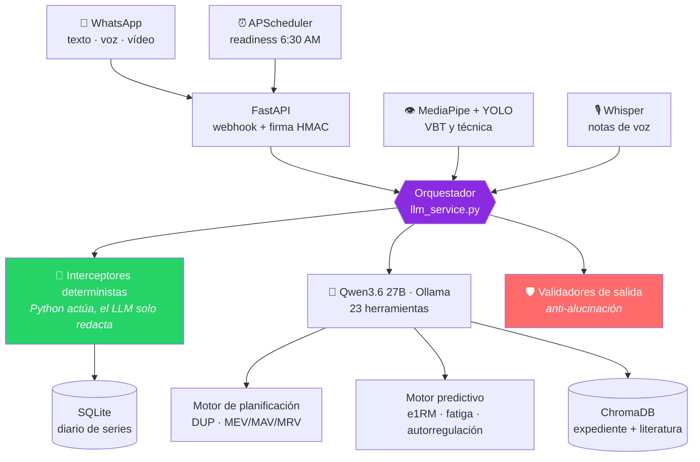

<div align="center">

# 🏋️ Iron Progress

### Un entrenador de fuerza que vive en tu WhatsApp

**Planifica tus mesociclos, calcula tus cargas, analiza tus vídeos y ajusta tu semana según tu fatiga real.**
Todo con un LLM que corre en local — sin enviar tus datos a ninguna nube.

<br>


</div>

---

## El problema

Una app de gimnasio te deja registrar series. Un entrenador de verdad hace algo muy distinto: **recuerda que te duele el hombro**, nota que llevas tres semanas estancado en banca, y te baja la carga el día que llegas reventado.

Iron Progress intenta ser lo segundo. Le escribes por WhatsApp como le escribirías a tu coach — *"acabo de sacar 100x5, me quedaron 2 en el tanque"* — y el sistema registra la serie, recalcula tu 1RM, y si ese esfuerzo no cuadra con lo planificado, reajusta lo que te queda del día.

> [!NOTE]
> Proyecto personal en desarrollo activo. El motor de planificación, el registro por texto/voz/vídeo y el análisis de fatiga funcionan de punta a punta contra un número real de WhatsApp.

<br>

## Cómo se siente usarlo

```
🧑  hola, llevo 3 años entrenando por mi cuenta pero me estanqué.
    quiero ganar músculo y fuerza en serio

🤖  Perfecto, apuntado: vamos a por ese powerbuilding serio para
    romper tu estancamiento. ¿Cuánto pesas ahora mismo?

           ── el sistema recolecta la ficha dato a dato y genera el plan ──

🧑  qué me toca hoy?

🤖  Hoy arrancamos con *Torso*. El foco es volumen controlado:
    • Press Banco Plano: 5x10 — *80 kg* @RPE 7.5
    • Remo en Máquina: 7x10 @RPE 7.5
    • Press Pecho en Máquina: 4x11 @RPE 8.0
    ...

🧑  la primera de banca me salió durísima, 100x5 y rpe 9.5

🤖  Recibido, queda registrada. Esa primera salió muy cara, así que
    ajusté el resto del bloque: *bajamos a 95 kg y solo harás 2 series
    más*, con un tope estricto de RPE 7.5.

🧑  cuántas series de pecho hago a la semana?

🤖  En tu plan actual llevas *13 series semanales* para pecho:
    • Día 1: 5 de Press Banca + 4 en máquina
    • Día 3: 3 de Press Banca + 1 en máquina
```

Los `95 kg` y las `2 series` **no los escribe el modelo**: los calcula el motor predictivo a partir del overshoot de RPE. El coach solo los transcribe. Esa distinción es el corazón del proyecto.

<br>

## Arquitectura



<br>

## Qué hace

<table>
<tr>
<td width="33%" valign="top">

### 📋 Planifica
Genera mesociclos completos con **periodización ondulante diaria (DUP)**, splits Torso/Pierna de 3 a 7 días y guardia de SNC (nunca dos días de fuerza pesada seguidos). El volumen se reparte por patrón de movimiento según los marcos MEV/MAV/MRV.

</td>
<td width="33%" valign="top">

### 📊 Mide
Calcula 1RM estimado con fórmulas científicas, sigue tu progreso por ejercicio y detecta si **excediste tu volumen recuperable** comparando rendimiento, esfuerzo a cargas emparejadas y síntomas articulares.

</td>
<td width="33%" valign="top">

### 🔄 Se adapta
Sustituye ejercicios si te duele algo o falta material, aplica descargas cuando los números lo confirman, y reajusta la sesión en curso si tu RPE se sale de lo prescrito.

</td>
</tr>
<tr>
<td valign="top">

### 👁️ Ve
Le mandas el vídeo de una serie y extrae métricas de **VBT** (velocidad media y pico, pérdida de velocidad, rango de movimiento) con MediaPipe, más un clasificador propio de ejercicios.

</td>
<td valign="top">

### 🎙️ Escucha
Nota de voz en pleno descanso: Whisper transcribe y el sistema extrae la tríada `ejercicio + peso + reps @ RPE` de un transcript caótico, con eco de confirmación.

</td>
<td valign="top">

### 🧠 Recuerda
Un expediente vectorial guarda tus molestias, tu material, tus horarios y tus manías. Si dices que se te quitó el hombro, deja de sacártelo. Un buen coach no pregunta dos veces lo mismo.

</td>
</tr>
</table>

<br>

## La parte interesante: hacer que un LLM no mienta

Un coach que se inventa los kilos es peor que no tener coach. El atleta *no puede verificar* lo que le dices, así que una alucinación se convierte en un mesociclo entrenado mal. Casi toda la ingeniería del proyecto va contra eso.

### 1. El LLM no calcula. Python calcula, el LLM redacta

Los interceptores deterministas parsean el mensaje y **ejecutan la acción** antes de que el modelo opine. El modelo recibe el resultado ya hecho y solo lo comunica con tono de entrenador:

```python
# El atleta escribe "listo la segunda igual, 100 por 4".
# Python detecta la serie, hereda el ejercicio del turno anterior
# (guarda con TTL de 30 min), lo registra en SQLite y recalcula el 1RM.
# Solo entonces el modelo escribe la frase.
```

### 2. Validadores de salida que auditan contra el disco

Antes de que la respuesta salga a WhatsApp pasa por varias redes:

| Red | Qué caza |
|---|---|
| **KG inventados** | Cualquier cifra en kg que no venga del plan, del historial o de una herramienta |
| **Rutina fantasma** | Texto con forma de rutina cuando no hay plan generado |
| **Claim falso** | Afirmar "ya lo registré" cuando ninguna escritura se completó |
| **Estado del plan** | Dar por aplicada una descarga, una pausa o un avance de día **contrastándolo contra el disco** |

Si una red salta, se fuerza una reescritura honesta; si el modelo reincide, responde una plantilla determinista escrita en Python. Cero bucles.

### 3. Secreto profesional

El atleta no sabe que hay un sistema detrás. Ningún nombre de función, tabla o herramienta llega nunca al chat: un filtro los sustituye antes de enviar.

<br>

## QA de comportamiento

Probar un agente conversacional no es probar funciones puras. Hay un banco de casos de uso que **habla con el orquestador completo** como lo haría un usuario real y emite un veredicto automático por caso:

```bash
# 30 casos cubriendo las 17 reglas de decisión del prompt
SIM_NUMERO=52155... python -m services.testbed.qa_casos_uso

# o solo un bloque temático
SIM_NUMERO=52155... python -m services.testbed.qa_casos_uso fatiga salud
```

```
[9/30] ✓  (regla 10)
  ATLETA : la primera serie de banca me salió durísima, 100x5 y rpe 9.5
  espera : autorregular_dia con los datos exactos; NO es descarga semanal
  tools  : ['registrar_serie_completada*', 'autorregular_dia*']   8.3s
```

El sufijo `*` marca lo que resolvió Python en vez del modelo. Además hay suites deterministas para el parser de marcas, el RPE hablado, el router de charla casual, las sustituciones fantasma, los claims de estado y el contrato `tools.json` ↔ handlers, más un smoke de 72 aserciones.

<br>

## Stack

| Capa | Tecnología |
|---|---|
| **API** | FastAPI · Uvicorn · webhook de WhatsApp Cloud API con validación HMAC |
| **LLM** | Qwen3.6 27B (Q4_K_M) sobre Ollama, 32k de contexto, thinking selectivo |
| **RAG** | ChromaDB + `nomic-embed-text` — expediente vivo del atleta y biblioteca científica |
| **Visión** | MediaPipe Pose · YOLO (Ultralytics) · OpenCV · clasificador propio (scikit-learn) |
| **Audio** | faster-whisper (`small`, int8 en CPU) |
| **Datos** | SQLite (telemetría y diario) · JSON (planes y estado) |
| **Proactividad** | APScheduler · Matplotlib para las gráficas de progreso |
| **Hardware** | Probado en AMD RX 7900 XTX (24 GB) con PyTorch ROCm |

<br>

## Puesta en marcha

> [!IMPORTANT]
> Necesitas una cuenta de **WhatsApp Business (Meta Cloud API)**, **Ollama** corriendo en local y **FFmpeg** en el sistema.

```bash
# 1. Dependencias
python -m venv .venv && source .venv/bin/activate

#    PyTorch va PRIMERO y desde el índice de tu GPU (aquí, ROCm)
pip install torch --index-url https://download.pytorch.org/whl/rocm6.2
pip install -r requirements.txt
sudo apt install ffmpeg

# 2. Modelos
ollama pull qwen3.6:27b
ollama pull nomic-embed-text

# 3. Credenciales
cp .env.example .env      # y rellena los tokens de Meta

# 4. Indexar la biblioteca científica (opcional pero recomendado)
#    Sin este paso el coach responde teoría de memoria en vez de citar fuentes.
pip install langchain-community langchain-text-splitters pypdf
#    coloca tus PDFs en scripts/resources/libros_cientificos/
python scripts/crear_base_conocimiento.py

# 5. Arrancar
python main.py            # health check en http://localhost:8000/
```

Expón el puerto con un túnel (ngrok, Cloudflare) y registra esa URL como webhook en el panel de Meta.

<br>

## Estructura

```
├── main.py                  # arranque, lifespan, scheduler proactivo
├── api/rutas_whatsapp.py    # webhook: firma, media, cola de vídeos
├── core/
│   ├── prompt.json          # system prompt: identidad y 17 reglas de decisión
│   ├── tools.json           # contrato de las 23 herramientas del LLM
│   └── ejercicios.py        # canonización de nombres de ejercicios
├── services/
│   ├── llm_service.py       # ⭐ orquestador: interceptores, tools, validadores
│   ├── motor_predictivo.py  # e1RM, fatiga, MRV, autorregulación
│   ├── handlers_v9.py       # handlers de las tools del motor predictivo
│   ├── vision_service.py    # MediaPipe + clasificador de ejercicios
│   ├── vbt_service.py       # métricas de velocidad del levantamiento
│   ├── audio_service.py     # Whisper
│   ├── proactividad.py      # readiness matutino y gráficas
│   └── testbed/             # 🧪 banco de QA y suites deterministas
├── scripts/Entrenamiento.py # motor de planificación (DUP, splits, volumen)
└── resources/               # base de ejercicios y planes generados
```

<br>

## Hoja de ruta

- [x] Onboarding conversacional y generación de mesociclos
- [x] Registro por texto, voz y vídeo
- [x] Autorregulación por RPE y análisis de MRV
- [x] Redes anti-alucinación con auditoría contra disco
- [x] Banco de QA de interacción
- [ ] Reducir el techo de razonamiento del modelo (fuente de las respuestas truncadas)
- [ ] Persistir los mensajes de herramientas para aprovechar mejor la caché de prompts
- [ ] Indicador de "escribiendo…" durante las esperas largas
- [ ] Panel web de seguimiento

<br>

---

<div align="center">

Hecho por **[@AbiGuadarrama](https://github.com/AbiGuadarrama)** · levantando pesas y depurando prompts

</div>
