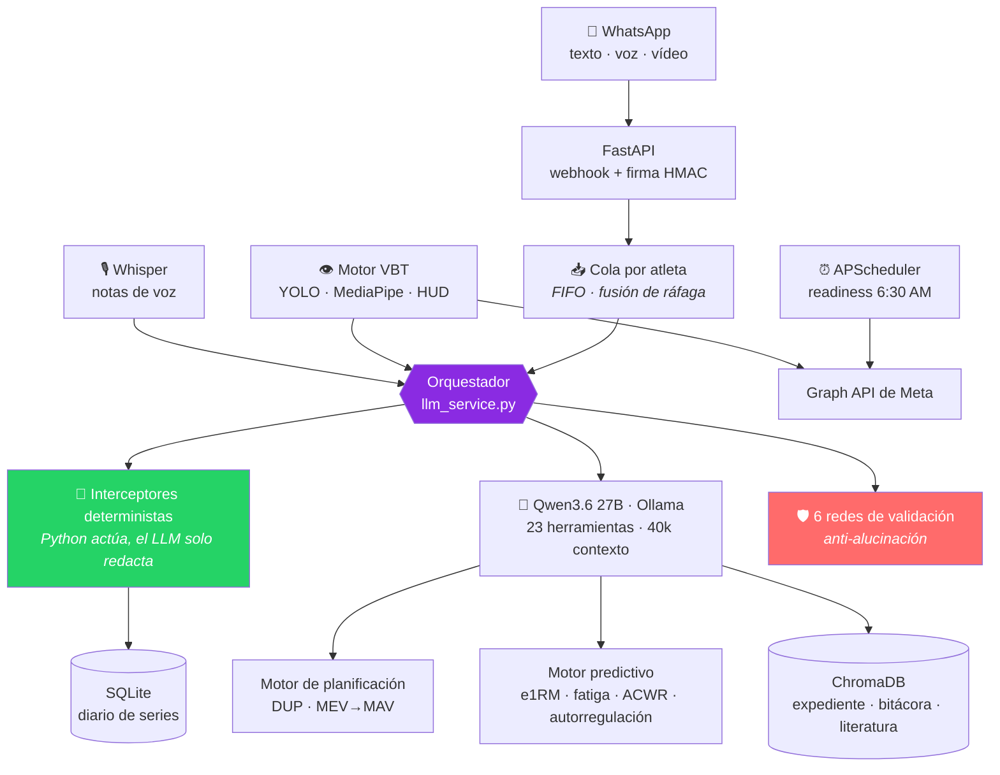
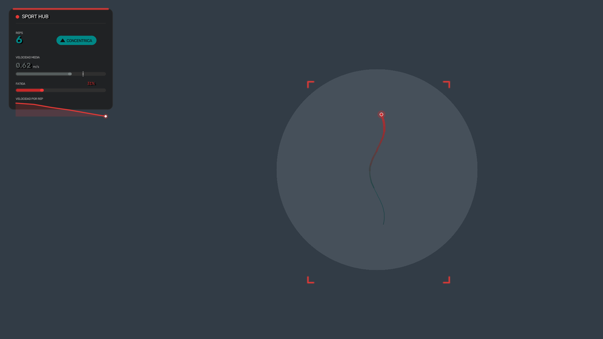

<div align="center">

# 🏋️ Iron Progress

### Un entrenador de fuerza que vive en tu WhatsApp

**Planifica tus mesociclos, calcula tus cargas, analiza tus vídeos y ajusta tu semana según tu fatiga real.**
Todo con un LLM que corre en local — sin enviar tus datos a ninguna nube.

<br>


</div>

---

## El problema

Una app de gimnasio te deja registrar series. Un entrenador de verdad hace algo muy distinto: **recuerda que te duele el hombro**, nota que llevas tres semanas estancado en banca, y te baja la carga el día que llegas reventado.

Iron Progress intenta ser lo segundo. Le escribes por WhatsApp como le escribirías a tu coach — *"acabo de sacar 100x5, me quedaron 2 en el tanque"* — y el sistema registra la serie, recalcula tu 1RM, y si ese esfuerzo no cuadra con lo planificado, reajusta lo que te queda del día.

> [!NOTE]
> Proyecto personal en desarrollo activo. El motor de planificación, el registro por texto/voz/vídeo y el análisis de fatiga funcionan de punta a punta contra un número real de WhatsApp.

<br>

## Cómo se siente usarlo

```
🧑  hola, llevo 3 años entrenando por mi cuenta pero me estanqué.
    quiero ganar músculo y fuerza en serio

🤖  Perfecto, apuntado: vamos a por ese powerbuilding serio para
    romper tu estancamiento. ¿Cuánto pesas ahora mismo?

           ── el sistema recolecta la ficha dato a dato y genera el plan ──

🧑  qué me toca hoy?

🤖  Hoy es *Día 1 · Torso*.
    • Press Banco Plano: 4x10 — *87.5 kg* @RPE 7.5
    • Dominadas Lastradas: 4x10 — *20 kg* @RPE 7.5
    • Press Pecho en Máquina: 2x11 — *67.5 kg* @RPE 8.0
    ...

🧑  la primera de banca me salió durísima, 100x5 y rpe 9.5

🤖  Recibido, queda registrada. Esa primera salió muy cara, así que
    ajusté el resto del bloque: *bajamos a 95 kg y solo harás 2 series
    más*, con un tope estricto de RPE 7.5.

🧑  cuántas series de pecho hago a la semana?

🤖  Esta semana tienes prescritas *15 series para pecho*:
    • Día 1: 4 de Press Banca + 2 en máquina
    • Día 3: 2 de Press Banca + 1 en máquina
    • Día 5: 4 de Press Banca + 2 en máquina
```

Los `87.5 kg`, las `15 series` y el ajuste a `95 kg` **no los escribe el modelo**: salen del plan en disco y del motor predictivo. El coach solo los transcribe. Esa distinción es el corazón del proyecto.

<br>

## Arquitectura



El trabajo proactivo de las 6:30 **no entra por el webhook**: llama directamente a la Graph API de Meta, y solo escribe a quien tiene sesión hoy o la lleva atrasada.

<br>

## Qué hace

<table>
<tr>
<td width="33%" valign="top">

### 📋 Planifica
Genera mesociclos completos con **periodización ondulante diaria (DUP)**, splits Torso/Pierna de 3 a 7 días y guardia de SNC (nunca dos días de fuerza pesada seguidos). El volumen se reparte por patrón de movimiento interpolando de **MEV a MAV** a lo largo del bloque.

</td>
<td width="33%" valign="top">

### 📊 Mide
Calcula 1RM estimado con fórmulas científicas, sigue tu progreso por ejercicio, calcula la **ratio de carga aguda/crónica (ACWR)** y detecta si excediste tu volumen recuperable comparando rendimiento, esfuerzo a cargas emparejadas y síntomas articulares.

</td>
<td width="33%" valign="top">

### 🔄 Se adapta
Sustituye ejercicios si te duele algo o falta material, aplica descargas cuando los números lo confirman, y reajusta la sesión en curso si tu RPE se sale de lo prescrito.

</td>
</tr>
<tr>
<td valign="top">

### 👁️ Ve
Le mandas el vídeo de una serie y te devuelve el **mismo vídeo con un HUD encima**: reps contadas, fase, velocidad y trayectoria de la barra. Debajo hay un motor de **VBT** de 3.200 líneas y un clasificador de ejercicios entrenado con vídeos propios.

</td>
<td valign="top">

### 🎙️ Escucha
Nota de voz en pleno descanso: Whisper transcribe y el sistema extrae la tríada `ejercicio + peso + reps @ RPE` de un transcript caótico, con eco de confirmación.

</td>
<td valign="top">

### 🧠 Recuerda
Tres memorias distintas: el **expediente** (molestias, material, horarios), la **bitácora narrativa** (mesociclos cerrados, lesiones viejas) y la **biblioteca científica**. Si dices que se te quitó el hombro, deja de sacártelo.

</td>
</tr>
</table>

<br>

## La parte interesante: hacer que un LLM no mienta

Un coach que se inventa los kilos es peor que no tener coach. El atleta *no puede verificar* lo que le dices, así que una alucinación se convierte en un mesociclo entrenado mal. Casi toda la ingeniería del proyecto va contra eso.

### 1. El LLM no calcula. Python calcula, el LLM redacta

Una quincena de interceptores deterministas parsean el mensaje y **ejecutan la acción** antes de que el modelo opine. El modelo recibe el resultado ya hecho y solo lo comunica con tono de entrenador:

```python
# El atleta escribe "listo la segunda igual, 100 por 4".
# Python detecta la serie, hereda el ejercicio del turno anterior
# (sello con ventana de 3 min para imponerlo, 30 min para heredarlo),
# comprueba que no sea un duplicado de los últimos 20 minutos,
# lo registra en SQLite y recalcula el 1RM.
# Solo entonces el modelo escribe la frase.
```

Los kilos de la rutina tampoco los inventa nadie: el plan guarda **porcentajes de 1RM**, y el orquestador los multiplica por tu marca guardada y los redondea a tu incremento real de disco. Si no hay marca de ese ejercicio, sale *peso por calibrar* — nunca un número improvisado.

### 2. Seis redes de validación que auditan contra el disco

Antes de que la respuesta salga a WhatsApp pasa por varias mallas:

| Red | Qué caza |
|---|---|
| **Kilajes inventados** | Cualquier cifra en kg que no venga del plan, del historial o de una herramienta |
| **Rutina fantasma** | Texto con forma de rutina cuando no hay plan generado |
| **Reparador de onboarding** | Preguntas fuera de orden o repetidas durante la recolección de la ficha |
| **Claim falso** | Afirmar "ya lo registré" cuando ninguna escritura se completó |
| **Estado del plan** | Dar por aplicada una descarga, una pausa o un avance de día **contrastándolo contra el disco** |
| **Anti-eco** | Repetir el mensaje anterior con otras palabras |

Si una red salta, se fuerza una reescritura honesta; si el modelo reincide, responde una plantilla determinista escrita en Python. Cero bucles.

### 3. Secreto profesional

El atleta no sabe que hay un sistema detrás. Ningún nombre de función, tabla o herramienta llega nunca al chat: un filtro los sustituye antes de enviar.

<br>

## La otra mitad: ver el levantamiento

El chat no es todo el proyecto. Cuando el atleta manda el vídeo de una serie, este devuelve **el vídeo anotado** más un análisis en texto — y ninguna de las dos cosas la escribe el LLM.

<div align="center">

</div>

### El motor VBT

`services/Creardataset.py` — 3.225 líneas de OpenCV, YOLO y MediaPipe. Detecta el disco, lo sigue frame a frame y saca:

| Familia | Métricas |
|---|---|
| **Velocidad** | media y pico por repetición, pérdida de velocidad contra la rep **más rápida** de la serie (no contra la primera: la 1ª casi nunca lo es) |
| **Trayectoria** | *bar path* — desviación horizontal máxima en cm y eficiencia del recorrido (vertical real / longitud del camino) |
| **Fases** | duración de la excéntrica, tiempo de amortiguación en el fondo (ms) y concéntrica |
| **Articular** | ángulo mínimo de rodilla y cadera, velocidad angular pico de extensión — opcional, vía YOLO-pose |
| **Derivadas** | e1RM del día por perfil carga-velocidad, y **reps en reserva** con doble estimador que se reconcilia en un rango entero |

El HUD de la imagen se renderiza sobre el vídeo original en formato vertical y se reenvía por WhatsApp. Un `analizar_serie` determinista redacta los hallazgos concretos — qué rep tuvo el mayor bajón, en cuál cortar para no pasar del 20 % de pérdida, cuánto ajustar la carga en kg — y el modelo solo los envuelve en lenguaje de entrenador.

> Las correcciones de la v3.3 salieron de medir sobre **grabaciones propias**, no de suponer: el filtro que ignoraba discos apilados descartaba también el disco de trabajo en peso muerto, y con él el primer tirón — YOLO veía el disco en el 99,6 % de los frames y el motor solo usaba el 55,7 %.

### El clasificador de ejercicios

Para saber *qué* está levantando sin preguntárselo, hay un modelo entrenado desde cero con un dataset grabado a mano:

```bash
python Entrenamiento_modelo_media/1_crear_dataset.py    # vídeos → 23 variables de pose por vídeo
python Entrenamiento_modelo_media/2_entrenar_modelo.py  # torneo de 5 algoritmos, gana el mejor
```

`1_crear_dataset.py` recorre una carpeta con un subdirectorio por ejercicio, pasa cada vídeo por MediaPipe Pose y comprime toda la serie temporal en **23 variables**: mínimo, máximo, rango, media y desviación de los ángulos de rodilla, cadera, codo y hombro, más tres de distancia muñeca–cadera. Descarta solo el vídeo en el que no se ve el cuerpo. El resultado es `datos_entrenamiento1.csv`: **49 vídeos grabados a mano** en cuatro clases —press banca, sentadilla, peso muerto y dominadas—.

`2_entrenar_modelo.py` enfrenta cinco algoritmos —Gradient Boosting, Random Forest, Regresión Logística, SVC y KNN, todos en `Pipeline` con `StandardScaler`— sobre el mismo split, exporta la comparativa a `comparacion_modelos.png` y empaqueta al ganador. **Ganó Gradient Boosting**, y es el `.pkl` que carga `vision_service.py` en producción. El clasificador además **marca como desconocido** lo que no reconoce con confianza, en vez de forzar una etiqueta.

Y el dataset se alimenta solo: cada vídeo que entra por WhatsApp se archiva en `data/dataset_recoleccion/` bajo la carpeta del ejercicio que se predijo. Hay **44 vídeos** acumulados esperando la siguiente ronda de entrenamiento.

> [!NOTE]
> `1_crear_dataset.py` tiene la carpeta de origen escrita a mano al final del fichero (`ruta_base`). Cámbiala por la tuya antes de reentrenar.

<br>

## QA de comportamiento

Probar un agente conversacional no es probar funciones puras. Hay un banco de **74 casos de uso repartidos en 22 bloques temáticos** que **habla con el orquestador completo** como lo haría un usuario real y emite un veredicto automático por caso:

```bash
# el banco entero, cubriendo las 17 reglas de decisión del prompt
SIM_NUMERO=52155... python -m services.testbed.qa_casos_uso

# o solo unos bloques temáticos
SIM_NUMERO=52155... python -m services.testbed.qa_casos_uso fatiga salud
```

```
[9/74] ✓  (regla 10)
  ATLETA : la primera serie de banca me salió durísima, 100x5 y rpe 9.5
  espera : autorregular_dia con los datos exactos; NO es descarga semanal
  tools  : ['registrar_serie_completada*', 'autorregular_dia*']   8.3s
```

El sufijo `*` marca lo que resolvió Python en vez del modelo. Además hay **32 suites deterministas** para el parser de marcas, el RPE hablado, el router de charla casual, las sustituciones fantasma, los claims de estado, la cola de mensajes, el turno exclusivo y el contrato `tools.json` ↔ handlers, más un smoke de 72 aserciones.

> [!TIP]
> El banco tiene ruido: ±1 acierto entre corridas es normal. Repite antes de culpar a un cambio.

<br>

## Stack

| Capa | Tecnología |
|---|---|
| **API** | FastAPI · Uvicorn · webhook de WhatsApp Cloud API con validación HMAC · cola FIFO por atleta |
| **LLM** | Qwen3.6 27B (Q4_K_M) sobre Ollama, **40 960 de contexto**, thinking selectivo por turno |
| **RAG** | ChromaDB + `nomic-embed-text` — expediente, bitácora narrativa y biblioteca científica |
| **Visión** | MediaPipe Pose · YOLO (Ultralytics) · OpenCV — motor VBT propio con HUD renderizado sobre el vídeo |
| **ML propio** | scikit-learn — clasificador de ejercicios (Gradient Boosting) entrenado sobre 44 vídeos y 23 variables de pose |
| **Audio** | faster-whisper (`small`, int8 en CPU) |
| **Datos** | SQLite (7 tablas en dos bases) · JSON (planes y estado) |
| **Proactividad** | APScheduler · Matplotlib para las gráficas de progreso |
| **Hardware** | Probado en AMD RX 7900 XTX (24 GB) con PyTorch ROCm |

> [!IMPORTANT]
> El nombre del modelo está en **dos** sitios independientes: `services/llm_service.py` (`MODELO_LLM`) y `scripts/resources/Entrenamiento_llm_peticion.py`. Cambiar solo el primero deja el generador de planes pidiendo un modelo que quizá no tengas.

<br>

## Puesta en marcha

> [!IMPORTANT]
> Necesitas una cuenta de **WhatsApp Business (Meta Cloud API)** y **Ollama** corriendo en local.

```bash
# 1. Dependencias
python -m venv .venv && source .venv/bin/activate

#    PyTorch va PRIMERO y desde el índice de tu GPU (aquí, ROCm)
pip install torch --index-url https://download.pytorch.org/whl/rocm6.2
pip install -r requirements.txt

# 2. Modelos
ollama pull qwen3.6:27b
ollama pull nomic-embed-text

# 3. Credenciales
cp .env.example .env      # y rellena los tokens de Meta

# 4. Indexar la biblioteca científica  ← NO es opcional
#    Sin este paso, 'consultar_libro_cientifico' y 'explicar_tecnica_ejercicio'
#    devuelven vacío: dos de las 23 herramientas quedan muertas.
pip install langchain-community langchain-text-splitters pypdf
#    coloca tus PDFs en scripts/resources/libros_cientificos/
python scripts/crear_base_conocimiento.py     # ~1 min: 1.007 páginas → 3.852 fragmentos

# 5. Arrancar
python main.py            # health check en http://localhost:8000/
```

El clasificador de ejercicios viaja ya entrenado en `Entrenamiento_modelo_media/clasificador_ejercicios.pkl`, así que **no hay que reentrenarlo** para arrancar. Solo si añades vídeos nuevos al dataset: `1_crear_dataset.py` y después `2_entrenar_modelo.py`.

Expón el puerto con un túnel (ngrok, Cloudflare) y registra esa URL como webhook en el panel de Meta.

<br>

## Preparar una demostración

Media docena de funciones solo tienen algo que decir con meses de historial detrás. Para no esperar cuatro meses:

```bash
# 1. Un atleta con 16 semanas de entrenamiento creíble (~15 s, plan incluido)
python3 scripts/sembrar_demo.py --limpiar

# 2. Semanas de conversación previa + bitácora de mesociclos cerrados
python3 scripts/sembrar_conversacion.py

# 3. Pasar lista a las 21 comprobaciones antes de que haya público
python3 scripts/verificar_demo.py
```

El sembrado escribe exactamente lo que escribiría el sistema en producción: las mismas tablas, los mismos ficheros y las mismas claves canónicas. Genera una progresión realista —mesociclos de cuatro semanas con su descarga, ruido en el RPE, un estancamiento deliberado en banca y molestias puntuales ya resueltas— y termina en el **pico de carga** de un mesociclo, que es donde el análisis de volumen recuperable tiene algo que decir.

`verificar_demo.py` comprueba contra el sistema real que cada pieza responde: que `predecir_carga_optima` no diga «datos insuficientes», que el ACWR caiga en zona creíble, que ningún ejercicio del plan salga como *peso por calibrar*, y que las tres memorias devuelvan algo.

<br>

## Estructura

```
├── main.py                  # arranque, lifespan, scheduler proactivo
├── api/
│   ├── rutas_whatsapp.py    # webhook: firma, media, indicador de escribiendo
│   └── cola_mensajes.py     # cola FIFO por atleta, fusión de ráfaga
├── core/
│   ├── prompt.json          # system prompt: identidad y 17 reglas de decisión
│   ├── tools.json           # contrato de las 23 herramientas del LLM
│   ├── ejercicios.py        # canonización de nombres de ejercicios
│   └── config.py            # settings y diagnóstico de variables ausentes
├── services/
│   ├── llm_service.py       # ⭐ orquestador (7.792 l.): interceptores, tools, validadores
│   ├── motor_predictivo.py  # e1RM, fatiga, ACWR, autorregulación
│   ├── handlers_v9.py       # handlers del motor predictivo y sello de ejercicio
│   ├── calculadora_rm.py    # fórmulas de 1RM por tipo de ejercicio
│   ├── metricas_atleta.py   # perfil físico y nivel de fuerza relativo
│   ├── repositorio_atleta.py # perfil, marcas y su historial fechado
│   ├── db_service.py        # telemetría y panel analítico
│   ├── Creardataset.py      # 👁️ motor VBT (3.225 l.): bar path, fases, RIR, HUD
│   ├── vbt_service.py       # puente: vídeo de WhatsApp → motor VBT → respuesta
│   ├── vision_service.py    # MediaPipe + clasificador de ejercicios
│   ├── audio_service.py     # Whisper
│   ├── proactividad.py      # readiness matutino y gráficas
│   ├── proactive_coach.py   # detección de alertas y avisos no solicitados
│   └── testbed/             # 🧪 74 casos de QA + 32 suites deterministas
├── scripts/
│   ├── Entrenamiento.py     # motor de planificación (DUP, splits, volumen)
│   ├── crear_base_conocimiento.py  # ingesta de la biblioteca científica
│   ├── sembrar_demo.py      # atleta con meses de historial, en segundos
│   ├── sembrar_conversacion.py     # su pasado conversacional y narrativo
│   └── verificar_demo.py    # pasa lista antes de salir a demostrar
├── Entrenamiento_modelo_media/     # 🤖 dataset propio y torneo de clasificadores
├── data/                    # bases SQLite, planes, estado y vídeos del dataset
├── docs/                    # documentación técnica (PDF/DOCX) y plan de demostración
└── resources/               # base de ejercicios y planes generados
```

<br>

## Documentación

| Documento | Qué contiene |
|---|---|
| [`docs/Iron_Progress_Documentacion_Tecnica.pdf`](docs/Iron_Progress_Documentacion_Tecnica.pdf) | Memoria técnica completa: decisión de diseño central, arquitectura, ciclo de vida de un mensaje, anatomía de un turno del orquestador, interceptores y defensas. También en `.docx`, y se regenera con `docs/fuentes/generar_docx.py` |
| [`docs/PLAN_DEMOSTRACION.md`](docs/PLAN_DEMOSTRACION.md) | Guion operativo de 20-25 minutos, con los tiempos **medidos** en la máquina de desarrollo |

<br>

## Hoja de ruta

- [x] Onboarding conversacional y generación de mesociclos
- [x] Registro por texto, voz y vídeo
- [x] Autorregulación por RPE y análisis de volumen recuperable
- [x] Redes anti-alucinación con auditoría contra disco
- [x] Banco de QA de interacción
- [x] Persistir los mensajes de herramientas para aprovechar la caché de prompts
- [x] Indicador de "escribiendo…" durante las esperas largas
- [x] Cola por atleta en vez de descartar el mensaje cuando hay otro en proceso
- [x] Registrar varias series de un solo mensaje, distinguiendo `4x8 con 60 kg` (prescripción) de `100x5` (marca)
- [x] HUD renderizado sobre el vídeo y devuelto por WhatsApp
- [ ] Cerrar mesociclos automáticamente en la bitácora narrativa *(hoy solo la siembra el script de demo)*
- [ ] Cálculo inverso de 1RM ("¿cuántas reps con 110 para llegar a 140?")
- [ ] Panel web de seguimiento

<br>

---

<div align="center">

Hecho por **[@AbiGuadarrama](https://github.com/AbiGuadarrama)** · levantando pesas y depurando prompts

</div>
